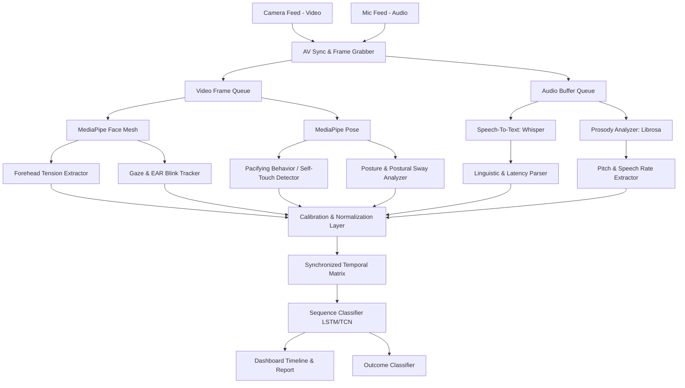

# AuraAssess: Multimodal AI Interview Behavior & Outcome Predictor
## System Design Document

This document outlines the architecture, processing pipelines, and methodologies for a real-time (or post-session) camera and audio-based system. The system extracts psychological parameters from candidate video and audio feeds to predict behavioral traits (e.g., anxiety, engagement, confidence) and interview outcomes.

---

## 1. System Architecture

AuraAssess employs a **Late Fusion Multimodal Architecture with Sequence Processing**. Raw video and audio streams are ingested, synchronized, and processed by separate, dedicated extraction pipelines. The extracted features are calibrated against a baseline, aligned temporally, and passed to a sequence-based prediction engine (LSTM/TCN) to evaluate behavioral events.



---

## 2. Psychological Parameters & Extraction Methods

The system tracks six key behavioral parameters verified by psychological literature to correlate with stress, confidence, cognitive load, and engagement.

| Parameter | Sensor Input | AI Tracking Method | Psychological Indicator | Technical Stack |
| :--- | :--- | :--- | :--- | :--- |
| **1. Forehead Tension** | Video | Action Unit (AU) 1, 2, & 4 tracking via mesh distances. | Furrowing or raising eyebrows indicates high cognitive load, confusion, or stress. | MediaPipe Face Mesh, OpenCV |
| **2. Eye Gaze & Blink Rate** | Video | Pupil tracking & Eyelid Aspect Ratio (EAR) mapping. | High blink rates / shifting gaze suggest stress or disengagement; sustained gaze suggests confidence. | MediaPipe Iris & Face Mesh |
| **3. Pacifying Behaviors** | Video | Hand-to-face, hand-to-neck, or hand-to-arm intersection checks. | Self-soothing touches (rubbing neck, touching face) heavily correlate with anxiety or nervous spikes. | MediaPipe Pose |
| **4. Postural Sway & Lean** | Video | Torso bounding box & shoulder angle tracking over time. | Leaning in shows engagement; excessive lateral swaying or slouching indicates disinterest or restlessness. | MediaPipe Pose |
| **5. Vocal Prosody** | Audio | Pitch ($F_0$) tracking, intensity, and voice energy variance. | Flat, monotonous speech indicates low energy/rehearsed answers; micro-tremors in pitch indicate stress. | Librosa, Parselmouth |
| **6. Speech Latency** | Audio | Silence duration detection between prompt and response. | Abnormally long pauses before answering suggest high cognitive effort, hesitation, or anxiety. | Whisper (timestamps), Librosa |

---

## 3. Detailed Parameter Mathematical & Technical Specifications

### Parameter 1: Forehead Tension (FACS AU1, AU2, AU4)
Using **MediaPipe Face Mesh** (468 landmarks), we capture coordinates of the eyebrows and forehead.
- **Eyebrow Furrowing (AU4 - Corrugator Muscle)**: Measure the Euclidean distance $D_{brow}$ between inner eyebrow landmarks (e.g., landmark 70 and 300) normalized by outer eye corner distance $D_{eye-width}$:
  $$\text{Furrow Index} = \frac{\|P_{70} - P_{300}\|}{\|P_{33} - P_{263}\|}$$
  A sustained reduction in this distance indicates forehead furrowing (stress/concentration).
- **Eyebrow Raising (AU1 / AU2)**: Measure vertical offset of eyebrow center relative to pupil centers.

### Parameter 2: Eye Gaze & Blink Tracking (EAR & Deviation)
- **Eye Aspect Ratio (EAR)**:
  $$\text{EAR} = \frac{\|P_{p2} - P_{p6}\| + \|P_{p3} - P_{p5}\|}{2 \|P_{p1} - P_{p4}\|}$$
  A blink is registered when $\text{EAR}$ falls below a threshold (e.g., $\approx 0.2$) for 2-4 consecutive frames. We count **Blinks per Minute (BPM)**.
- **Gaze Deviation**: Track the distance of the iris center from eye corners to establish camera alignment.

### Parameter 3: Pacifying Behaviors (Self-Touching)
Using **MediaPipe Pose**, we extract 3D skeleton keypoints.
- **Face & Neck Intersections**: Let $P_{Hand}$ be the coordinates of either wrist, $P_{Nose}$ be the nose tip, and $P_{Neck}$ be the average of the left/right shoulders (landmark 11 and 12).
  $$\text{Pacifying Event} = \mathbb{I}\left(\|P_{Hand} - P_{Nose}\| < \theta_{face} \;\lor\; \|P_{Hand} - P_{Neck}\| < \theta_{neck}\right)$$
  Where thresholds $\theta_{face}$ and $\theta_{neck}$ are scaled dynamically to the candidate's shoulder-width.

### Parameter 4: Postural Sway & Lean Angle
- **Lean Angle**: Spine inclination (mid-shoulder to mid-hip) relative to vertical:
  $$\theta_{lean} = \arctan\left(\frac{x_{shoulder} - x_{hip}}{y_{shoulder} - y_{hip}}\right)$$
- **Postural Sway (Restlessness)**: Quantified as the rolling variance of the lateral torso displacement ($x_{torso}$) over a 5-second sliding window:
  $$\text{Sway Score} = \text{Var}\left( \{ x_{torso}(t-k) \}_{k=0}^{K} \right)$$
  High variance represents persistent fidgeting or shifting of weight.

### Parameter 5: Vocal Prosody
Using **Librosa** on 3-second overlapping audio windows:
- **Pitch ($F_0$) Variance**: Extracted using the pYIN algorithm. High variation in $F_0$ denotes emotional engagement, whereas very narrow variation (flatline pitch) represents monotone speech (low energy or rehearsals).
- **Voice Energy Variance**: Rolling standard deviation of Root Mean Square (RMS) energy.

### Parameter 6: Speech Latency
Determined by aligning audio timestamps:
- **Prompt End Timestamp ($T_{prompt\_end}$)** and **Response Start Timestamp ($T_{resp\_start}$)**.
  $$\text{Speech Latency} = T_{resp\_start} - T_{prompt\_end}$$
  Detected by applying voice activity detection (VAD) on the audio stream and mapping whisper transcript segments.

---

## 4. Multimodal Fusion & Predictive Engine

```
[Frame-Level Extraction] -> [Synchronized Temporal Matrix] -> [LSTM or TCN Sequence Model] 
                                                                     |
                                                                     v
                                                          [Outcome Prediction]
```

### In-Session Calibration (Baseline phase)
To adjust for neurodiversity and cultural variations:
1. **Calibration Phase**: During the first 60 seconds (answering neutral, low-stress questions), the system records baseline averages: $\mu_{EAR}$, $\mu_{BPM}$, $\mu_{sway}$, and $\mu_{pitch}$.
2. **Normalization**: During the interview, all extracted values are normalized using Z-score styling:
   $$z(t) = \frac{x(t) - \mu_{baseline}}{\sigma_{baseline}}$$

### Sequence Modeling
Instead of static classification, aligned feature sequences are processed using:
- **Long Short-Term Memory (LSTM)** or **Temporal Convolutional Networks (TCN)**.
- These capture temporal contexts, such as a high-stress question leading to a rise in speech latency followed by a spike in pacifying gestures.

---

## 5. Non-Functional & Ethical Requirements

- **Real-Time Latency**: Edge execution latency $< 150\text{ms}$.
- **Privacy & Security**: Raw video and audio are processed purely in RAM on-edge and immediately discarded; only anonymized temporal feature metrics are stored.
- **Bias Mitigation**: Using baseline calibration to evaluate deviations from personal baselines, rather than comparing against a rigid global benchmark.

---
*Created for c:\Users\Animesh\Desktop\behavior anaylis*

